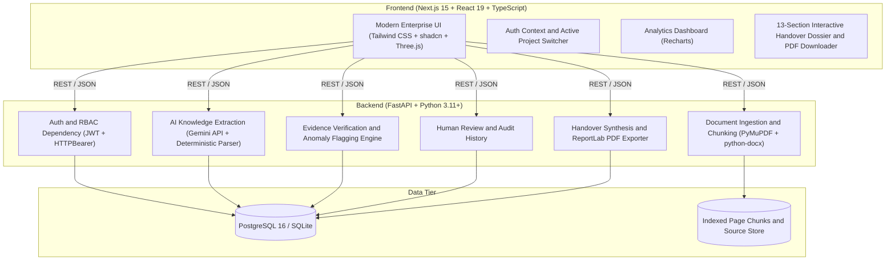

# KNOWLEDGE CONTINUITY
> **Evidence-Linked Project Knowledge Handover Platform**

[](https://knowledge-continuity-rho.vercel.app)
[](https://knowledge-continuity-api.onrender.com/docs)
[](https://nextjs.org/)
[](https://fastapi.tiangolo.com/)
[](https://www.typescriptlang.org/)
[](https://python.org/)
[](LICENSE)

---

## 1. Executive Summary

When critical team members leave an organization, irreplaceable tribal knowledge, architectural decisions, unwritten dependencies, and risk contexts often evaporate with them.

**Knowledge Continuity** is an enterprise-grade, full-stack knowledge preservation platform. It ingests authorized project documentation (PDF, DOCX, TXT), reconstructs the project state, verifies every single finding against exact source page quotations, flags conflicting dates and ambiguous ownership, enables structured managerial review, and synthesizes an official 13-section handover package for incoming engineers—complete with PDF export and backend-enforced RBAC.

---

## 2. Architecture & Tech Stack



| Layer | Technologies |
|---|---|
| **Frontend** | Next.js 15 (App Router), React 19, TypeScript, Tailwind CSS, Lucide Icons, Recharts, Three.js |
| **Backend** | Python 3.11+, FastAPI, Pydantic v2, SQLAlchemy 2.0, Alembic, Passlib (bcrypt), PyJWT |
| **Document Processing** | PyMuPDF (`fitz`), `python-docx`, UTF-8 chunker preserving page numbers and word boundaries |
| **AI Extraction Engine** | Google Gemini API (`gemini-1.5-flash` / `gemini-1.5-pro`) with structured JSON schema output + deterministic zero-hallucination NLP heuristic fallback |
| **Evidence & Verification** | Bidirectional quote matching, string alignment scoring, contradiction detection, and ambiguous ownership flagger |
| **PDF Generation** | ReportLab 5.1 (Enterprise styling, tables, evidence citations, sign-off banners) |
| **Database** | SQLite (development) / PostgreSQL 16 with pgvector (production) |

---

## 3. Core Features & Platform Modules

### A. Authentication & Backend-Enforced RBAC
- Passwords hashed using `bcrypt` (12 rounds).
- JWT access tokens with 24-hour expiration.
- FastAPI dependency `check_project_access` checks roles on every protected endpoint.
- **Roles:**
  - `ADMIN`: Full access to all projects, documents, reviews, and platform settings.
  - `PROJECT_MANAGER`: Full management, review workspace, sign-offs, and handover generation.
  - `OUTGOING_MEMBER`: Uploads source documents, contributes project context, reviews evidence.
  - `INCOMING_MEMBER`: Viewing restricted strictly to **manager-approved** handovers and verified evidence. Unapproved drafts and internal review queues are protected with `403 Forbidden`.

### B. Source Ingestion & Page-Level Chunking
- Supports **PDF**, **DOCX**, and **TXT** files.
- Drag-and-drop multi-file upload with 25MB validation.
- SHA-256 deduplication to prevent redundant indexing.
- Page preservation: every chunk strictly records its `page_number`, `chunk_index`, and character offsets.

### C. AI Knowledge Extraction (10 Entity Types)
Extracts structured facts strictly backed by citations:
1. `DECISION`: Architectural and organizational choices.
2. `TASK`: Concrete engineering action items.
3. `RESPONSIBILITY`: Explicit role assignments.
4. `DEADLINE`: Dates and target delivery quarters.
5. `MILESTONE`: High-level release targets.
6. `RISK`: Technical debt, single points of failure, scalability bottlenecks.
7. `BLOCKER`: Active impediments requiring escalation.
8. `DEPENDENCY`: Third-party APIs, vendor couplings, upstream services.
9. `QUESTION`: Unresolved architectural questions or open RFCs.
10. `CONTACT`: Domain leads, DevOps contacts, and vendor representatives.

### D. Evidence Verification & Contradiction Detection
- Validates extracted facts against original source chunks using sequence matching.
- Flags contradictory timelines (e.g., milestone dates conflicting across sprint notes).
- Highlights ambiguous ownership to ensure accountability.

### E. Human Review & Managerial Sign-Off
- Dedicated review workspace with side-by-side evidence inspection.
- Managers can approve, edit, or reject findings with a full audit log.

### F. Handover Dossier & PDF Export
- Synthesizes an executive 13-section onboarding package.
- Direct export to downloadable PDF via ReportLab with professional enterprise layout.

---

## 4. Quick Start Guide

### Prerequisites
- **Node.js**: v18+ (v20+ recommended)
- **Python**: v3.11+
- **Git**

### Automated Launch (Windows)
Double-click `start_all.bat` or run the PowerShell script from the project root:
```powershell
.\start_all.ps1
```
This automatically verifies dependencies, seeds the database, and boots both frontend and backend servers.

---

### Manual Step-by-Step Setup

#### 1. Backend Setup
```bash
# Navigate to project root and activate virtual environment
.\backend\venv\Scripts\activate

# Set python path (Windows PowerShell)
$env:PYTHONPATH = "."

# Seed the database with users and sample Apollo project data
python backend/seed_data.py

# Start FastAPI backend
uvicorn backend.app.main:app --reload --port 8000
```
API Documentation will be live at: [http://localhost:8000/docs](http://localhost:8000/docs)

#### 2. Frontend Setup
```bash
# Open another terminal and navigate to frontend
cd frontend

# Install dependencies (if not already installed)
npm install

# Start Next.js development server
npm run dev
```
Frontend UI will be live at: [http://localhost:3000](http://localhost:3000)

---

### Docker Compose
```bash
docker compose up --build
```

---

## 5. Demo Accounts

All demo accounts use password: `Password123!`

| Role | Email | Purpose |
|---|---|---|
| **ADMIN** | `admin@knowledgecontinuity.io` | Full system administration and audit inspection |
| **PROJECT_MANAGER** | `pm@knowledgecontinuity.io` | Review workspace, edit findings, approve handovers |
| **OUTGOING_MEMBER** | `outgoing@knowledgecontinuity.io` | Uploads architecture documents and sprint logs |
| **INCOMING_MEMBER** | `incoming@knowledgecontinuity.io` | Views approved handover report & onboarding plan |

> **Interactive Role Tester**: Use the role buttons in the sidebar footer to switch roles with a single click and test backend permission boundaries immediately!

---

## 6. End-to-End Workflow

| Step | Action | Endpoint / Engine | UI View |
|---|---|---|---|
| 1 | Register / Login | `POST /api/v1/auth/login` | Login / Auth Provider |
| 2 | Create Project | `POST /api/v1/projects` | Projects Switcher Modal |
| 3 | Add Members | `POST /api/v1/projects/{id}/members` | Team & Permissions View |
| 4 | Upload Documents | `POST /api/v1/projects/{id}/documents` | Sources View (Dropzone) |
| 5 | Page Chunking | PyMuPDF & python-docx parser | Chunk Inspector Drawer |
| 6 | AI Fact Extraction | Gemini API / Deterministic NLP | Knowledge Base Explorer |
| 7 | Evidence Verification | SequenceMatcher quote matching | Evidence Modal Inspector |
| 8 | Conflict Detection | Chronological conflict analyzer | Conflicting Tag in Knowledge |
| 9 | Human Review | `POST /api/v1/review/{id}/findings/{f_id}` | Review Workspace Queue |
| 10 | Manager Sign-Off | Approval status & audit recording | Approval Badge & Audit Log |
| 11 | Handover Generation | `POST /api/v1/handovers/{id}/generate` | Handover Dossier (13 Sections) |
| 12 | PDF Export | `GET /api/v1/handovers/{id}/{h_id}/export-pdf` | ReportLab PDF Download |
| 13 | Incoming Member View | Role-enforced filtered access | Handover Reader (Redacted Drafts) |

---

## 7. Automated Test Suite

Run the full automated test suite to verify foundation, auth, document ingestion, and AI extraction:

```bash
# Phase 1: Foundation & Database Schemas
python backend/test_phase1_foundation.py

# Phase 2: Auth, RBAC & Project Management
python backend/test_phase2_auth_projects.py

# Phase 3: Document Ingestion & Chunking Pipeline
python backend/test_phase3_document_pipeline.py

# Phase 4: AI Extraction Engine
python backend/test_phase4_ai_engine.py

# Phase 5: Knowledge Reconstruction
python backend/test_phase5_knowledge_reconstruction.py

# Phase 6: Evidence Verification & Conflict Detection
python backend/test_phase6_evidence_conflicts.py
```

---

## 8. Team Details

- **Team**: Team-Web_hunters
- **Project**: Knowledge Continuity
- **GitHub Repository**: [https://github.com/Veeresh23-06/Knowledge-Continuity](https://github.com/Veeresh23-06/Knowledge-Continuity)
- **Live Application**: [https://knowledge-continuity-rho.vercel.app](https://knowledge-continuity-rho.vercel.app)
- **Interactive API Docs**: [https://knowledge-continuity-api.onrender.com/docs](https://knowledge-continuity-api.onrender.com/docs)
